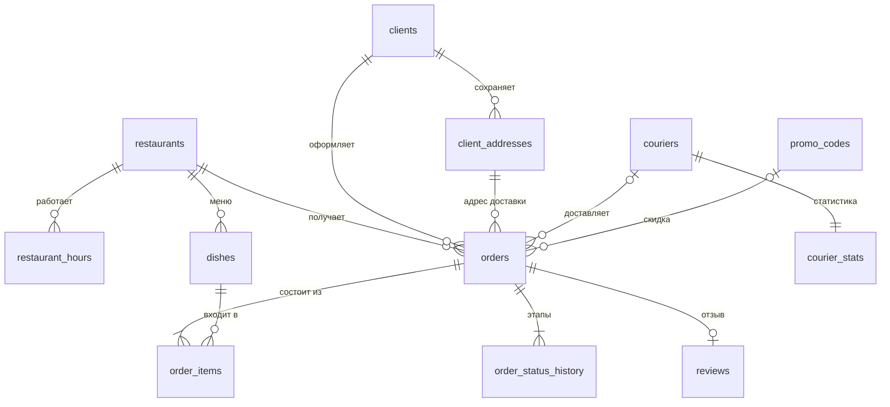

# Проектирование БД сервиса доставки еды (Часть 1)

**Студент:** Кулибаев Адилет, группа 24.246
**СУБД:** PostgreSQL 16

## ER-диаграмма

Обозначения: `||` — ровно один, `|o` — ноль или один, `o{` — ноль или много, `|{` — один или много.

---

## Задание 1.1: Сущности

| № | Название сущности | Что хранит | Почему это отдельная сущность |
|---|---|---|---|
| 1 | **restaurants** (Рестораны) | Название, адрес, рейтинг, открыт/закрыт | Самостоятельный объект со своими атрибутами; на него ссылаются блюда, расписание и заказы |
| 2 | **restaurant_hours** (Время работы) | День недели, время открытия и закрытия | Время работы различается по дням (Пн–Пт, Сб–Вс). Строка «Пн-Пт 10:00-22:00» в одной ячейке нарушила бы 1НФ: по ней нельзя искать и проверять. У ресторана много записей → отдельная таблица (1:N) |
| 3 | **dishes** (Блюда / меню) | Название, описание, цена, вес, категория, доступность | У блюда свои атрибуты; одно блюдо — в одном ресторане, ресторан — много блюд. Отдельная таблица «меню» не нужна: меню ресторана = все его блюда |
| 4 | **clients** (Клиенты) | Имя, телефон, email | Самостоятельный объект; оформляет заказы и оставляет отзывы |
| 5 | **client_addresses** (Адреса клиентов) | Улица, квартира, комментарий для курьера | У клиента **несколько** адресов. Хранить их колонками (address1, address2, …) нельзя — количество заранее неизвестно, это нарушение 1НФ. Заказ ссылается на конкретный адрес |
| 6 | **couriers** (Курьеры) | Имя, телефон, транспорт, на смене или нет | Самостоятельный объект; назначается на заказы |
| 7 | **courier_stats** (Статистика курьера) | Число доставок, сумма чаевых, средняя оценка | «Система отслеживает статистику курьера». Это вычисляемые данные, которые часто меняются (после каждой доставки) и обновляются триггерами; вынесены из `couriers`, чтобы не смешивать анкету курьера со счётчиками. Связь 1:1 |
| 8 | **orders** (Заказы) | Клиент, ресторан, адрес, курьер, статус, суммы, чаевые | Главная сущность процесса; связывает клиента, ресторан, адрес и курьера |
| 9 | **order_items** (Позиции заказа) | Заказ, блюдо, количество, цена на момент заказа | **Связующая таблица M:N**: в заказе много блюд, блюдо входит во много заказов. Хранит атрибуты самой связи — количество и цену |
| 10 | **order_status_history** (История статусов) | Заказ, статус, время перехода | «Фиксируется время каждого этапа». У заказа до 6 этапов; хранить 6 колонок времени неудобно и неполно. Одна строка = один этап (1:N) |
| 11 | **reviews** (Отзывы) | Оценка ресторану, оценка курьеру, комментарий | Отзыв — отдельное событие со своими данными и датой; бывает не у каждого заказа. Связь 1:1 с заказом |
| 12 | **promo_codes** (Промокоды) — *бонус* | Код, % скидки, мин. сумма, срок действия, лимит | Бонусное задание «система промокодов». Один промокод используется во многих заказах (1:N) |

**Почему не отдельные таблицы, а ENUM:** категории блюд (5 штук), статусы заказа и виды транспорта — фиксированные списки из условия задачи, у них нет собственных атрибутов. Для них используются типы `ENUM` (`dish_category`, `order_status`, `transport_type`): база сама не даст записать другое значение, а лишние JOIN не нужны. Если список категорий станет часто меняться, правильнее вынести его в таблицу `categories`.

---

## Задание 1.2: Атрибуты

### 1. РЕСТОРАНЫ (restaurants)

| Атрибут | Тип данных | PK/FK/- | NOT NULL? | UNIQUE? | DEFAULT | Описание |
|---|---|---|---|---|---|---|
| restaurant_id | SERIAL | PK | Да | Да | auto | Уникальный идентификатор |
| name | VARCHAR(200) | - | Да | Нет | - | Название (CHECK: не пустое) |
| address | VARCHAR(500) | - | Да | Нет | - | Физический адрес |
| rating | DECIMAL(2,1) | - | Да | Нет | 0.0 | Средний рейтинг 0.0–5.0 (0.0 — отзывов нет), считается триггером |
| is_open | BOOLEAN | - | Да | Нет | TRUE | Открыт или временно закрыт |
| created_at | TIMESTAMP | - | Да | Нет | CURRENT_TIMESTAMP | Дата регистрации |

### 2. ВРЕМЯ РАБОТЫ (restaurant_hours)

| Атрибут | Тип данных | PK/FK/- | NOT NULL? | UNIQUE? | DEFAULT | Описание |
|---|---|---|---|---|---|---|
| restaurant_id | INTEGER | PK, FK → restaurants | Да | Нет (уникальна пара) | - | Ресторан |
| day_of_week | SMALLINT | PK | Да | Нет (уникальна пара) | - | День недели 1 (пн) … 7 (вс), CHECK 1–7 |
| open_time | TIME | - | Да | Нет | - | Время открытия |
| close_time | TIME | - | Да | Нет | - | Время закрытия; если меньше open_time — работает после полуночи. CHECK: ≠ open_time |

Составной первичный ключ `(restaurant_id, day_of_week)`: одна запись на день. Нет строки — выходной.

### 3. БЛЮДА (dishes)

| Атрибут | Тип данных | PK/FK/- | NOT NULL? | UNIQUE? | DEFAULT | Описание |
|---|---|---|---|---|---|---|
| dish_id | SERIAL | PK | Да | Да | auto | Идентификатор блюда |
| restaurant_id | INTEGER | FK → restaurants | Да | Нет | - | Ресторан-владелец |
| name | VARCHAR(200) | - | Да | Да, в пределах ресторана (UNIQUE restaurant_id + name) | - | Название |
| description | TEXT | - | Нет | Нет | NULL | Описание (необязательно) |
| price | DECIMAL(10,2) | - | Да | Нет | - | Текущая цена, ₸. CHECK > 0 |
| weight_grams | INTEGER | - | Да | Нет | - | Вес в граммах. CHECK > 0 |
| category | dish_category (ENUM) | - | Да | Нет | - | salad / soup / hot / dessert / drink |
| is_available | BOOLEAN | - | Да | Нет | TRUE | Временно недоступно = FALSE |
| created_at | TIMESTAMP | - | Да | Нет | CURRENT_TIMESTAMP | Когда добавлено в меню |

Цена — `DECIMAL`, а не `REAL/FLOAT`: деньги нужно хранить точно, без ошибок округления.

### 4. КЛИЕНТЫ (clients)

| Атрибут | Тип данных | PK/FK/- | NOT NULL? | UNIQUE? | DEFAULT | Описание |
|---|---|---|---|---|---|---|
| client_id | SERIAL | PK | Да | Да | auto | Идентификатор клиента |
| full_name | VARCHAR(150) | - | Да | Нет | - | Имя |
| phone | VARCHAR(20) | - | Да | Да | - | Телефон; CHECK формат `+` и 10–15 цифр |
| email | VARCHAR(255) | - | Да | Да | - | Email; CHECK формат `x@y.z` |
| created_at | TIMESTAMP | - | Да | Нет | CURRENT_TIMESTAMP | Дата регистрации |

Телефон — `VARCHAR`, а не число: в нём есть `+`, ведущие нули, с ним не делают арифметику.

### 5. АДРЕСА КЛИЕНТОВ (client_addresses)

| Атрибут | Тип данных | PK/FK/- | NOT NULL? | UNIQUE? | DEFAULT | Описание |
|---|---|---|---|---|---|---|
| address_id | SERIAL | PK | Да | Да | auto | Идентификатор адреса |
| client_id | INTEGER | FK → clients | Да | Нет | - | Владелец адреса |
| label | VARCHAR(50) | - | Нет | Нет | NULL | «Дом», «Работа» |
| city | VARCHAR(100) | - | Да | Нет | 'Алматы' | Город |
| street | VARCHAR(300) | - | Да | Нет | - | Улица и дом |
| apartment | VARCHAR(20) | - | Нет | Нет | NULL | Квартира/офис (бывает «12А») |
| comment | TEXT | - | Нет | Нет | NULL | Подсказка курьеру |
| created_at | TIMESTAMP | - | Да | Нет | CURRENT_TIMESTAMP | Когда сохранён |

Дополнительно `UNIQUE (address_id, client_id)` — нужен для составного внешнего ключа из `orders` (см. связи).

### 6. КУРЬЕРЫ (couriers)

| Атрибут | Тип данных | PK/FK/- | NOT NULL? | UNIQUE? | DEFAULT | Описание |
|---|---|---|---|---|---|---|
| courier_id | SERIAL | PK | Да | Да | auto | Идентификатор курьера |
| full_name | VARCHAR(150) | - | Да | Нет | - | Имя |
| phone | VARCHAR(20) | - | Да | Да | - | Телефон; CHECK формат |
| transport | transport_type (ENUM) | - | Да | Нет | - | walk / bicycle / motorcycle / car |
| is_on_shift | BOOLEAN | - | Да | Нет | FALSE | На смене (доступен) |
| created_at | TIMESTAMP | - | Да | Нет | CURRENT_TIMESTAMP | Дата найма |

### 7. СТАТИСТИКА КУРЬЕРА (courier_stats)

| Атрибут | Тип данных | PK/FK/- | NOT NULL? | UNIQUE? | DEFAULT | Описание |
|---|---|---|---|---|---|---|
| courier_id | INTEGER | PK и FK → couriers | Да | Да | - | Курьер (PK = FK → связь 1:1) |
| total_deliveries | INTEGER | - | Да | Нет | 0 | Число доставленных заказов, CHECK ≥ 0 |
| total_tips | DECIMAL(12,2) | - | Да | Нет | 0 | Сумма чаевых, CHECK ≥ 0 |
| avg_rating | DECIMAL(2,1) | - | Да | Нет | 0.0 | Средняя оценка курьера, 0.0–5.0 |
| last_delivery_at | TIMESTAMP | - | Нет | Нет | NULL | Последняя доставка (NULL — ещё не было) |

Строка создаётся триггером при добавлении курьера, обновляется триггерами при доставке, чаевых и отзыве.

### 8. ЗАКАЗЫ (orders)

| Атрибут | Тип данных | PK/FK/- | NOT NULL? | UNIQUE? | DEFAULT | Описание |
|---|---|---|---|---|---|---|
| order_id | SERIAL | PK | Да | Да | auto | Номер заказа |
| client_id | INTEGER | FK → clients | Да | Нет | - | Кто заказал |
| restaurant_id | INTEGER | FK → restaurants | Да | Нет | - | Из какого ресторана (все блюда — из него) |
| address_id | INTEGER | FK → client_addresses (составной с client_id) | Да | Нет | - | Куда везти |
| courier_id | INTEGER | FK → couriers | Нет | Нет | NULL | Курьер; NULL — ещё не назначен |
| promo_id | INTEGER | FK → promo_codes | Нет | Нет | NULL | Промокод (бонус) |
| status | order_status (ENUM) | - | Да | Нет | 'created' | Текущий статус |
| subtotal | DECIMAL(10,2) | - | Да | Нет | 0 | Сумма блюд, считает триггер |
| discount_amount | DECIMAL(10,2) | - | Да | Нет | 0 | Скидка по промокоду, считает триггер |
| total_amount | DECIMAL(10,2) | - | Да | Нет | 0 | К оплате = subtotal − discount |
| tip_amount | DECIMAL(10,2) | - | Да | Нет | 0 | Чаевые курьеру, CHECK ≥ 0 |
| comment | TEXT | - | Нет | Нет | NULL | Комментарий к заказу |
| created_at | TIMESTAMP | - | Да | Нет | CURRENT_TIMESTAMP | Время создания |
| updated_at | TIMESTAMP | - | Да | Нет | CURRENT_TIMESTAMP | Время последней смены статуса |

CHECK-ограничения: суммы ≥ 0; скидка ≤ subtotal; `total_amount = subtotal − discount_amount`; в статусах `delivering`/`delivered` обязателен курьер; чаевые только при наличии курьера.

### 9. ПОЗИЦИИ ЗАКАЗА (order_items)

| Атрибут | Тип данных | PK/FK/- | NOT NULL? | UNIQUE? | DEFAULT | Описание |
|---|---|---|---|---|---|---|
| order_id | INTEGER | PK, FK → orders | Да | Нет (уникальна пара) | - | Заказ |
| dish_id | INTEGER | PK, FK → dishes | Да | Нет (уникальна пара) | - | Блюдо |
| quantity | INTEGER | - | Да | Нет | 1 | Количество порций, CHECK > 0 |
| price_at_order | DECIMAL(10,2) | - | Да | Нет | - (ставит триггер) | Цена на момент заказа, CHECK > 0 (бонус «история цен») |

Составной PK `(order_id, dish_id)`: одно блюдо — одна строка в заказе, порции — в `quantity`.

### 10. ИСТОРИЯ СТАТУСОВ (order_status_history)

| Атрибут | Тип данных | PK/FK/- | NOT NULL? | UNIQUE? | DEFAULT | Описание |
|---|---|---|---|---|---|---|
| order_id | INTEGER | PK, FK → orders | Да | Нет (уникальна пара) | - | Заказ |
| status | order_status (ENUM) | PK | Да | Нет (уникальна пара) | - | Этап |
| changed_at | TIMESTAMP | - | Да | Нет | CURRENT_TIMESTAMP | Когда наступил этап |

Составной PK `(order_id, status)`: каждый этап заказ проходит один раз. Заполняется только триггером.

### 11. ОТЗЫВЫ (reviews)

| Атрибут | Тип данных | PK/FK/- | NOT NULL? | UNIQUE? | DEFAULT | Описание |
|---|---|---|---|---|---|---|
| review_id | SERIAL | PK | Да | Да | auto | Идентификатор отзыва |
| order_id | INTEGER | FK → orders | Да | **Да** | - | Заказ (UNIQUE → один отзыв на заказ) |
| restaurant_rating | SMALLINT | - | Да | Нет | - | Оценка ресторану, CHECK 1–5 |
| courier_rating | SMALLINT | - | Нет | Нет | NULL | Оценка курьеру 1–5, необязательна |
| comment | TEXT | - | Нет | Нет | NULL | Текст отзыва |
| created_at | TIMESTAMP | - | Да | Нет | CURRENT_TIMESTAMP | Дата отзыва |

`client_id` и `restaurant_id` здесь **не хранятся**: они однозначно определяются через заказ. Их копия была бы транзитивной зависимостью (нарушение 3НФ) и могла бы разойтись с заказом.

### 12. ПРОМОКОДЫ (promo_codes) — бонус

| Атрибут | Тип данных | PK/FK/- | NOT NULL? | UNIQUE? | DEFAULT | Описание |
|---|---|---|---|---|---|---|
| promo_id | SERIAL | PK | Да | Да | auto | Идентификатор |
| code | VARCHAR(30) | - | Да | Да | - | Текст кода, CHECK заглавные буквы |
| discount_percent | SMALLINT | - | Да | Нет | - | Скидка, CHECK 1–100 % |
| min_order_amount | DECIMAL(10,2) | - | Да | Нет | 0 | Минимальная сумма блюд |
| valid_from | TIMESTAMP | - | Да | Нет | CURRENT_TIMESTAMP | Начало действия |
| valid_until | TIMESTAMP | - | Нет | Нет | NULL | Конец действия (NULL — бессрочно), CHECK > valid_from |
| max_uses | INTEGER | - | Нет | Нет | NULL | Лимит использований (NULL — без лимита) |
| is_active | BOOLEAN | - | Да | Нет | TRUE | Включён ли промокод |

---

## Задание 1.3: Связи

| № | Сущность A | Сущность B | Тип связи | Где FK? | ON DELETE | Обоснование |
|---|---|---|---|---|---|---|
| 1 | Ресторан | Блюдо | 1:N | В `dishes.restaurant_id` | CASCADE | Удалили ресторан — его меню теряет смысл |
| 2 | Ресторан | Время работы | 1:N | В `restaurant_hours.restaurant_id` | CASCADE | Расписание без ресторана не нужно |
| 3 | Ресторан | Заказ | 1:N | В `orders.restaurant_id` | RESTRICT | Нельзя потерять историю заказов и выручки |
| 4 | Клиент | Адрес | 1:N | В `client_addresses.client_id` | CASCADE | Адреса принадлежат клиенту |
| 5 | Клиент | Заказ | 1:N | В `orders.client_id` | RESTRICT | Заказы — финансовая история |
| 6 | Адрес | Заказ | 1:N | В `orders (address_id, client_id)` — составной | RESTRICT | Нужно знать, куда был доставлен заказ |
| 7 | Курьер | Заказ | 1:N (у заказа 0 или 1 курьер) | В `orders.courier_id` (NULL допускается) | RESTRICT | Доставленный заказ обязан иметь курьера |
| 8 | Курьер | Статистика курьера | 1:1 | В `courier_stats.courier_id` (он же PK) | CASCADE | Статистика без курьера не нужна |
| 9 | Промокод | Заказ | 1:N (у заказа 0 или 1 промокод) | В `orders.promo_id` (NULL допускается) | SET NULL | Скидка уже посчитана и сохранена в заказе |
| 10 | Заказ | Блюдо | **M:N** через `order_items` | — | — | В заказе много блюд, блюдо во многих заказах |
| 10а | Заказ | Позиция заказа | 1:N | В `order_items.order_id` | CASCADE | Позиции — часть заказа |
| 10б | Блюдо | Позиция заказа | 1:N | В `order_items.dish_id` | RESTRICT | Нельзя стереть блюдо из прошлых заказов |
| 11 | Заказ | История статусов | 1:N | В `order_status_history.order_id` | CASCADE | Этапы — часть заказа |
| 12 | Заказ | Отзыв | 1:1 (отзыв может отсутствовать) | В `reviews.order_id` + UNIQUE | CASCADE | Отзыв относится к конкретному заказу |

### Объяснение по каждой связи

Общее правило для «где FK»: в связи 1:N внешний ключ ставится на стороне **N** («многие»). Строка «многих» ссылается на одного «родителя». Наоборот сделать нельзя: в одной ячейке родителя пришлось бы хранить список id, а это нарушение 1НФ.

**1. Ресторан — Блюдо (1:N, CASCADE)**
1. У ресторана много блюд, а блюдо по условию «принадлежит только одному ресторану» → 1:N.
2. FK в `dishes`: каждое блюдо знает своего единственного владельца.
3. CASCADE: блюда не существуют без ресторана. Но если по блюдам уже были заказы, удаление всё равно будет заблокировано (`order_items → dishes RESTRICT`, `orders → restaurants RESTRICT`), поэтому историю потерять нельзя. Закрытый ресторан помечается `is_open = FALSE`.

**2. Ресторан — Время работы (1:N, CASCADE)**
1. У ресторана до 7 записей (по дням недели), запись относится к одному ресторану.
2. FK в `restaurant_hours` (сторона N); он же входит в составной PK.
3. CASCADE: расписание — служебные данные ресторана.

**3. Ресторан — Заказ (1:N, RESTRICT)**
1. Ресторан получает много заказов; заказ по условию — из ОДНОГО ресторана.
2. FK в `orders`. Хранение ресторана в заказе позволяет триггеру проверять, что все позиции из него.
3. RESTRICT: удаление ресторана не должно молча стирать заказы клиентов, чеки и отзывы.

**4. Клиент — Адрес (1:N, CASCADE)**
1. У клиента «может быть несколько сохранённых адресов», адрес — одного клиента.
2. FK в `client_addresses`.
3. CASCADE: адреса — личные данные клиента, без него не нужны. Если по адресу были заказы, удаление заблокирует связь 6 (RESTRICT).

**5. Клиент — Заказ (1:N, RESTRICT)**
1. Клиент делает много заказов, у заказа один клиент.
2. FK в `orders`.
3. RESTRICT: заказы — финансовые документы. Клиента с заказами удалить нельзя (можно, например, обезличить его данные).

**6. Адрес — Заказ (1:N, RESTRICT, составной FK)**
1. На один адрес можно сделать много заказов; заказ «доставляется на один из адресов клиента».
2. FK в `orders`, причём составной: `(address_id, client_id) → client_addresses (address_id, client_id)`. Обычный FK по `address_id` разрешил бы указать адрес *другого* клиента. Составной ключ проверяет, что пара «адрес + клиент» существует, — это требование «на один из адресов **клиента**» прямо в схеме, без триггера.
3. RESTRICT: адрес доставки — часть истории заказа.

**7. Курьер — Заказ (1:N, RESTRICT)**
1. Курьер за смену доставляет много заказов; у заказа не больше одного курьера.
2. FK в `orders`; `courier_id` может быть NULL, пока курьер не назначен (связь необязательная).
3. RESTRICT, а не SET NULL: CHECK `courier_required` требует курьера у заказов в статусах `delivering`/`delivered`, а статистика и чаевые привязаны к курьеру. Уволенного курьера не удаляют, а снимают со смены.

**8. Курьер — Статистика (1:1, CASCADE)**
1. У каждого курьера ровно одна строка статистики, и она принадлежит одному курьеру.
2. FK в `courier_stats` и одновременно его PK. Именно PK гарантирует «не больше одной строки на курьера», то есть 1:1. Таблица зависимая: создаётся после курьера (триггером).
3. CASCADE: статистика без курьера бессмысленна.

**9. Промокод — Заказ (1:N, SET NULL)**
1. Один промокод применяют во многих заказах; в заказе — не больше одного промокода.
2. FK в `orders`, необязательный (NULL — без промокода).
3. SET NULL: сумма скидки уже сохранена в `orders.discount_amount`, поэтому при удалении промокода заказ остаётся корректным — пропадает только ссылка на код. Триггер `trg_apply_promo` не пересчитывает суммы заказов, уже принятых рестораном; у ещё не принятого заказа скидка просто исчезнет вместе с промокодом.

**10. Заказ — Блюдо (M:N через order_items)**
1. В заказе «несколько разных блюд», и одно блюдо встречается во многих заказах → многие-ко-многим. В реляционной БД M:N реализуется связующей таблицей.
2. Два FK в `order_items`: на `orders` и на `dishes`. Составной PK `(order_id, dish_id)`. В связующей таблице хранятся атрибуты связи: `quantity` и `price_at_order`.
3. `order_items → orders` CASCADE: позиции — часть заказа; удалили заказ — позиции не нужны.
   `order_items → dishes` RESTRICT: если блюдо уже заказывали, удалить его нельзя (иначе прошлые заказы потеряют состав). Блюдо убирают из продажи через `is_available = FALSE`.

**11. Заказ — История статусов (1:N, CASCADE)**
1. Заказ проходит до 6 этапов, каждая запись истории — об одном заказе.
2. FK в `order_status_history`; составной PK `(order_id, status)` запрещает дважды записать один этап.
3. CASCADE: история — часть заказа.

**12. Заказ — Отзыв (1:1, CASCADE)**
1. По условию отзыв оставляется о выполненном заказе. На один заказ — не больше одного отзыва, и отзыв относится к одному заказу → 1:1 (необязательная: отзыва может не быть).
2. FK в `reviews`: отзыв появляется после заказа, и не у каждого заказа он есть. Если поставить FK в `orders`, у большинства заказов он был бы NULL. 1:1 обеспечивает `UNIQUE (order_id)`.
3. CASCADE: отзыв о несуществующем заказе не имеет смысла.

---

## Нормализация

**1НФ** — все значения атомарны, нет повторяющихся групп:
- время работы — отдельные строки по дням, а не текст «Пн-Пт 10:00-22:00»;
- адреса клиента — отдельная таблица, а не колонки address1, address2;
- состав заказа — таблица `order_items`, а не список блюд в одной ячейке;
- этапы заказа — строки `order_status_history`, а не 6 колонок времени.

**2НФ** — в таблицах с составным ключом каждый неключевой атрибут зависит от всего ключа:
- `order_items (order_id, dish_id)`: `quantity` и `price_at_order` зависят от пары «этот заказ + это блюдо». Название блюда зависит только от `dish_id`, поэтому его здесь нет;
- `restaurant_hours (restaurant_id, day_of_week)`: время зависит от пары «ресторан + день»;
- `order_status_history (order_id, status)`: время зависит от пары «заказ + этап».

**3НФ** — нет транзитивных зависимостей (неключевое поле не зависит от другого неключевого):
- в `reviews` нет `client_id` и `restaurant_id` — они берутся через `order_id`;
- в `order_items` нет названия и категории блюда — они в `dishes`;
- в `orders` нет адреса текстом — только ссылка на `client_addresses`.

**Осознанная денормализация** (данные, которые можно вычислить, хранятся готовыми ради скорости и поддерживаются триггерами, поэтому не расходятся с исходными):
- `restaurants.rating` — средняя оценка; иначе каждый показ списка ресторанов требовал бы пересчёта по всем отзывам;
- `orders.subtotal / discount_amount / total_amount` — сумма заказа; нужна в каждом чеке и в отчётах;
- `courier_stats` — счётчики курьера.

**Не денормализация:** `order_items.price_at_order`. Это не копия `dishes.price`, а отдельный факт — цена в момент покупки. Когда цена в меню изменится, старые заказы должны сохранить ту сумму, которую клиент реально заплатил (бонус «история цен»).

---

## Бизнес-правила и где они реализованы

| Правило из условия | Где реализовано |
|---|---|
| Рейтинг 1–5, цена > 0, количество > 0, вес > 0 | CHECK в `schema.sql` |
| Блюдо — одной категории из пяти | ENUM `dish_category` |
| Заказ содержит блюда только из ОДНОГО ресторана | `orders.restaurant_id` + триггер `trg_check_order_item` |
| Недоступное блюдо нельзя заказать | триггер `trg_check_order_item` |
| Заказ доставляется на один из адресов **этого** клиента | составной FK `fk_order_address` |
| Статусы идут строго по порядку, без возврата назад | триггер `trg_check_status_change` (Вариант A) |
| Отмена только до статуса «готовится» | триггер `trg_check_status_change` |
| Фиксируется время каждого этапа | триггеры `trg_log_status_*` → `order_status_history` |
| Везти заказ без курьера нельзя | CHECK `courier_required` |
| Отзыв — только о выполненном заказе, один на заказ | триггер `trg_check_review` + UNIQUE |
| Сумма заказа считается автоматически | триггеры `trg_recalc_order_total`, `trg_apply_promo` |
| Рейтинг ресторана пересчитывается по отзывам | триггер `trg_update_ratings` |
| Статистика курьера | таблица `courier_stats` + триггеры |
| Чаевые курьеру | `orders.tip_amount`, суммируются в `courier_stats.total_tips` |
